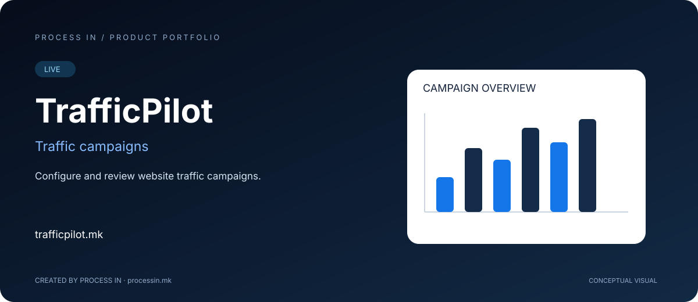

# TrafficPilot

**Постави и прегледај кампањи за веб-сообраќај.**

[English](README.md) · [Македонски](README.mk.md)

**LIVE**

## Што претставува

TrafficPilot претставува услуга за поставување кампањи за веб-сообраќај. Јавниот сајт опишува целни URL адреси, географско насочување, избор на извор и извештаи. Презентацијата ги опишува контролите без ветувања за рангирање, продажба или независно потврден квалитет.

## Дефинирај кампања пред да го разгледаш бројот на посети

Оператор што оценува услуга за веб-сообраќај треба да ги разбере дестинацијата, насочувањето, изворите и извештаите. Самиот број на посети не покажува дали услугата одговара на намената.

TrafficPilot претставува контроли за поставување кампањи. Операторот одредува дестинација и ги разгледува географијата, изворот и опциите. Јавниот сајт содржи и демо пристап за оценување.

### Практичен пристап за процена

Одреди што сакаш да оцениш пред почеток. Избери целна страница, разгледај поставки и дефинирај како ќе ги прегледуваш резултатите. Метриките за испорака разгледувај ги одделно од деловниот резултат.

Презентацијата ги опишува контролите за кампањи. Не тврди дека купениот или генерираниот сообраќај создава подобро рангирање, квалификувани клиенти или продажба. Одлуката е дали услугата и условите одговараат на конкретната намена.

## Како работи

| Чекор | Постапка |
|---|---|
| 1 | Прочитај за услугата и условите |
| 2 | Одреди дестинација |
| 3 | Избери географија и извор |
| 4 | Прегледај кампања и аналитика |

## Главни можности

| Област | Можности |
|---|---|
| **Дестинација** | Целна веб-страница. |
| **Географија** | Опции за географско насочување. |
| **Извори** | Поставки за извор на сообраќај. |
| **Поставки** | Достапни опции за кампањата. |
| **Извештаи** | Информации за испорака и кампања. |
| **Демо** | Сајтот нуди демо регистрација. |

## Кому му е наменет

Оператори на веб-страници и маркетинг тимови што оценуваат услуги за веб-сообраќај.

## Практично сценарио

Оператор ги разгледува насочувањето и извештаите пред одлука за кампања. Квалитетот и деловните резултати се оценуваат одделно од бројот на посети.

## Искуство со производот

Визуелизацијата е концептуална, а не слика од апликацијата. Актуелниот интерфејс, опциите и условите се достапни на официјалната веб-страница.

## Информации за производот

| Податок | Вредност |
|---|---|
| Домен | [trafficpilot.mk](https://trafficpilot.mk/) |
| Категорија | Кампањи за веб-сообраќај |
| Статус | LIVE |
| Развој | [PROCESS IN](https://processin.mk) |
| Контакт за портфолио | [contact@processin.mk](mailto:contact@processin.mk) |

Извор: [Официјална веб-страница](https://trafficpilot.mk/).

### [Посети TrafficPilot](https://trafficpilot.mk/)

[PROCESS IN — Your Enterprise Software & AI Partner](https://processin.mk)

---

Јавна презентација на производ. Без приватен изворен код, кориснички податоци или продукциски тајни. Не доделува open-source лиценца за производот.

This platform is a digital product of <a href="https://processin.mk" target="_blank">PROCESS IN</a> · Your Enterprise Software & AI Partner ·  
Hosted on Enterprise Infrastructure by <a href="https://inhost.mk" target="_blank">INHOST</a> ·
